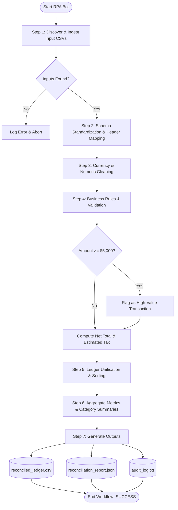

# RPA Workflow Specification: Multi-Source Financial Reconciliation Bot

## 1. Process Overview & Business Context

In enterprise financial operations, monthly accounting requires reconciling incoming sales revenue with outgoing supplier expenses. Disparate departments and vendors produce spreadsheets with inconsistent schemas, varying date conventions, raw currency symbols (`$`, `EGP`, commas), and missing audit metadata.

### Manual Baseline vs. RPA Bot:
- **Manual Baseline**: A financial clerk spends 3–4 hours cross-referencing CSVs, stripping symbols in Excel, calculating net values and estimated tax, flagging high-value transactions, and pasting summaries into reports.
- **RPA Bot Workflow**: An automated software bot executes the entire ingestion, cleaning, normalization, rule-based validation, reconciliation, categorization, and audit reporting pipeline in less than 2 seconds with zero transposition errors.

---

## 2. Process Flowchart

---

## 3. Detailed Step-by-Step Workflow Steps

### Step 1: Input Ingestion
- Ingests `data/inputs/sales_orders.csv` (Revenue records) and `data/inputs/supplier_expenses.csv` (Expenditure records).
- Validates file existence and readability.

### Step 2: Schema Standardization & Header Mapping
Standardizes mismatched field names into a unified transactional schema:
- `Order_Number` / `InvoiceID` $\rightarrow$ `transaction_id`
- `Order_Date` / `Date` $\rightarrow$ `date`
- `Customer_Name` / `Vendor` $\rightarrow$ `counterparty`
- `Item_Category` / `Category` $\rightarrow$ `category`
- `Quantity` $\times$ `Unit_Price` $\rightarrow$ `gross_amount` (for sales)
- `Total_Amount` $\rightarrow$ `gross_amount` (for expenses)
- Transaction type tagged as either `REVENUE` or `EXPENSE`.

### Step 3: Currency Cleaning & Data Normalization
- Removes currency symbols (`$`, `EGP`, `€`), thousand separators (`,`), and surrounding whitespace.
- Casts numeric fields to standard floating-point numbers.
- Normalizes dates to `YYYY-MM-DD`.

### Step 4: Business Rules & Anomaly Detection
- **Rule 1 (Audit Flagging)**: Any transaction with `gross_amount >= 5000.00` is flagged (`flagged_high_value = True`) for executive review.
- **Rule 2 (Tax Computation)**: Computes estimated 14% Value Added Tax (`estimated_tax = gross_amount * 0.14`).
- **Rule 3 (Net Balance Calculation)**: Calculates `net_amount = gross_amount` for revenues and `-gross_amount` for expenses.

### Step 5: Ledger Unification & Sorting
- Concatenates sales and expense records into a unified DataFrame.
- Sorts chronologically by `date` ascending.

### Step 6: Executive Reporting & Metrics Compilation
Computes executive metrics:
- Total Transactions Processed
- Gross Revenue
- Total Expenses
- Net Cash Flow (Revenue - Expenses)
- Total Estimated Tax Liability
- High-Value Flagged Items Count
- Category-level financial breakdown

### Step 7: Output Generation & Audit Logging
Writes three standardized deliverables:
1. `output/reconciled_ledger.csv`: Full reconciled ledger with standard columns.
2. `output/reconciliation_report.json`: Executive JSON audit report.
3. `output/audit_log.txt`: Timestamped, step-by-step transaction processing log.

---

## 4. Input & Output Schemas

### Standardized Unified Ledger Schema (`reconciled_ledger.csv`):
- `transaction_id` (string): Standardized ID (e.g., `SO-1001`, `INV-201`).
- `date` (string): Standard ISO date `YYYY-MM-DD`.
- `type` (string): `REVENUE` or `EXPENSE`.
- `counterparty` (string): Customer or Vendor name.
- `category` (string): Accounting category.
- `gross_amount` (float): Gross transaction amount.
- `estimated_tax` (float): Estimated tax (14%).
- `net_balance` (float): Positive for revenue, negative for expense.
- `status` (string): Payment status (`Completed`, `Paid`, `Pending`).
- `flagged_high_value` (boolean): `True` if $\ge 5000.00$, else `False`.
